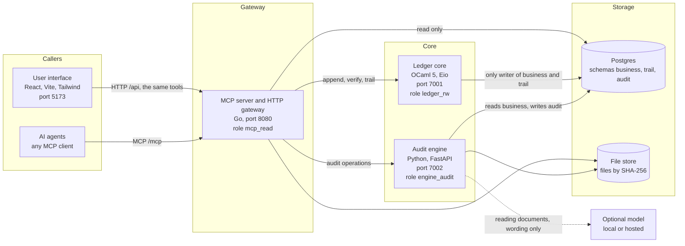
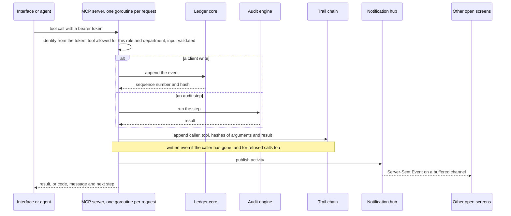
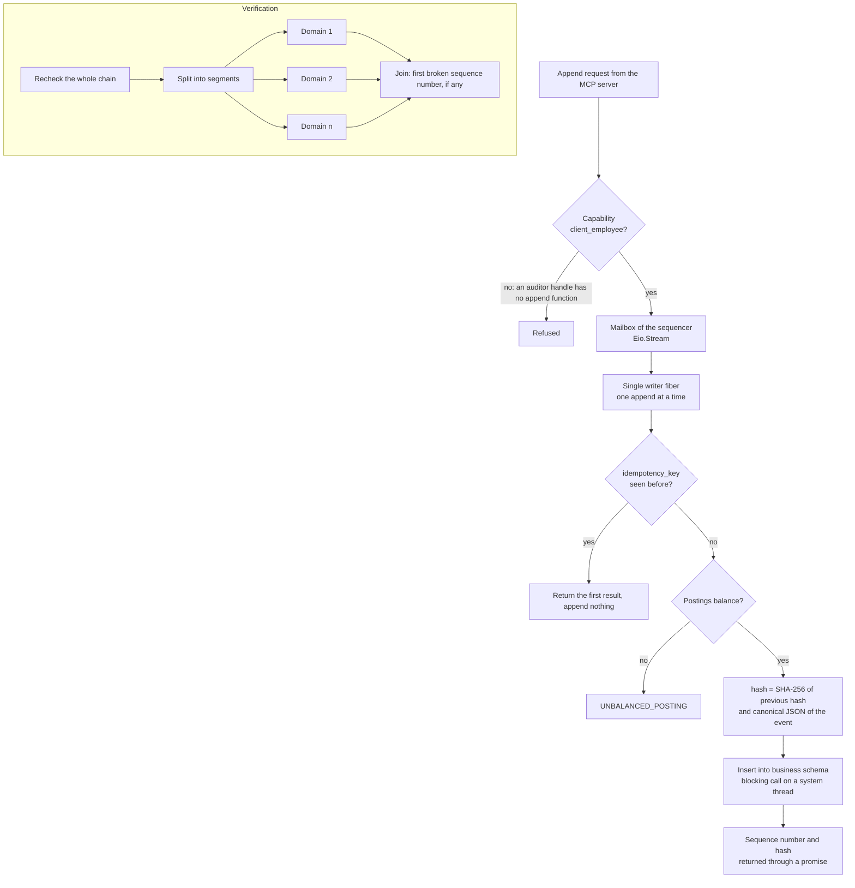
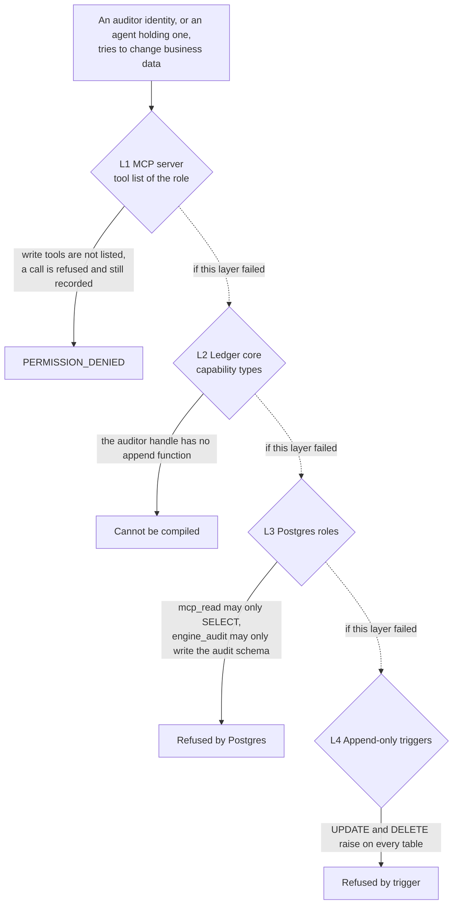

# Sanchay architecture

How the parts of Sanchay fit together, in five diagrams. Each diagram is followed by the decisions behind it and what they cost. The full specification is in [docs/PRD.md](docs/PRD.md), and the product is described in [README.md](README.md).

| Diagram | Shows |
|---|---|
| [1. System](#1-system) | The services, their languages, ports and database roles |
| [2. One tool call](#2-one-tool-call) | The single path every call takes, and how live updates reach the screens |
| [3. The ledger write path](#3-the-ledger-write-path) | How an event is sealed into the chain without the chain ever forking |
| [4. The audit](#4-the-audit) | From the client's upload to the manager's sign-off |
| [5. Four layers of protection](#5-four-layers-of-protection) | Why an auditor identity can never change the business data |

## 1. System

| Decision | Why | Cost |
|---|---|---|
| Four languages, one per job | Go for the busy, concurrent front door. OCaml for the ledger, where types can forbid an illegal write. Python for data, PDF, OCR, Excel and graph libraries. React for the screens. | More to build and run than one application |
| One database, separated by roles | Simple to run. Each service connects with its own role and can touch only its own schema. | Separation comes from roles, not from separate servers |
| Files stored by SHA-256 | The same file is stored once, and a file cannot be swapped without its hash changing | A file is found by hash, not by name |
| The model is optional and outside the core | The whole system runs with no model. A model only reads documents and words text. | Less automation where a model could have guessed |

## 2. One tool call

Every action, from a person in the interface or from an AI agent, is a tool call through the same door.

| Mechanism | Purpose |
|---|---|
| One goroutine per request (Go's HTTP server) | Many agents and screens call tools at the same time without waiting on each other |
| One MCP server per identity, cached behind a mutex | An identity only ever sees the tools of its role and department |
| `context.WithoutCancel` for the trail write | A call is recorded even when the caller disconnects, so refused attempts always reach the trail |
| Hub of buffered channels, non-blocking `select` send | A slow browser misses a notice instead of slowing every tool call |
| Server-Sent Events with a 20 second heartbeat | Screens update when someone else changes something. Updates flow one way, so SSE is simpler than WebSockets. |
| Errors carry `code`, `message` and `next_step` | An agent that hits an error is told what to do next |

## 3. The ledger write path

| Decision | Why | Cost |
|---|---|---|
| Capability types `client` and `auditor` | No function turns an auditor into a client, so the compiler rejects code that would let an auditor write | Every call site must carry the right capability |
| Single writer fiber with a mailbox | Two appends can never read the same previous hash, so the chain cannot fork. The idempotency check and the insert are one step. | Writes are serialized. A full year of 71,667 events still loads in about 8 minutes. |
| Canonical JSON shared with the engine | The ledger and the engine compute the same bytes, checked against shared test vectors | Both sides must follow the same canonical rules |
| Parallel verification on OCaml 5 domains | Rechecking every hash uses every core. A mutex lets one verification run at a time. | Verification is a heavier operation, so it runs on request, not on every write |
| A Merkle root for each day | One record can be proved to belong to its day without rechecking the chain | One more table to keep |

## 4. The audit

```mermaid
flowchart LR
    UP["Client uploads the register<br/>and related-party list"] --> SEAL["Seed sealed<br/>client receives the commitment"]
    SEAL --> OPEN["open_engagement<br/>snapshot frozen, seed derived"]
    OPEN --> REC["import and reconcile<br/>the register"]
    OPEN --> TAG["tag related parties"]
    TAG --> DET["16 detectors<br/>run in parallel threads"]
    REC --> SMP["select samples<br/>sales, cut-off, credit notes"]
    DET --> SMP
    SMP --> REQ["evidence requested<br/>with up to 3 control requests"]
    REQ --> EV["client answers<br/>a file or not available"]
    EV --> VER["9 evidence checks<br/>OCR, Hindi and Marathi"]
    VER --> CHG["changes after the snapshot"]
    CHG --> INT["ledger integrity"]
    INT --> OUT["memo, workpaper, summary"]
    OUT --> MGR["audit manager decides<br/>every finding"]
    MGR --> SIGN["sign-off"]
```

| Decision | Why | Cost |
|---|---|---|
| A frozen snapshot | Every test runs on the same data. A client change after testing begins becomes a finding instead of silently changing a result. | A client change is not seen by the tests until it is traced |
| A sealed seed | The seed comes from a secret sealed when the register arrived and from the snapshot hash. Nobody can choose the samples or draw again. | A seed chosen by hand is still allowed, and is reported as chosen |
| Deterministic steps | No model call and no clock value decide a finding, a sample or a figure. The same seed and snapshot give the same samples and the same workpaper. | Less room for judgement that a model might add |
| Steps that run once | A per-step lock stops a double click from running a step twice. A repeated call returns the stored result. | A step must be run again explicitly to recompute it |
| Detectors in a thread pool | They only read the frozen snapshot, so they run in parallel with no locks between them | The engine runs as one process, so its caches stay consistent |
| A person decides | Only the audit manager can confirm a finding or sign off, so the agent never confirms its own conclusions | Review takes a person's time |

## 5. Four layers of protection

| Layer | Where | What it stops |
|---|---|---|
| L1 Tool list | `mcp/internal/tools` | An identity cannot list or call a tool outside its role or department. The refusal is written to the trail. |
| L2 Capability types | `ledger/lib/capability.mli` | Code that would append for an auditor does not compile |
| L3 Database roles | `db/migrations/006_roles.sql` | The server reads only. The engine writes only the audit schema. Only the ledger writes business events. |
| L4 Triggers | `db/migrations/` | No row of any schema can be updated or deleted, even by a bug in our own code |

Each layer holds on its own, so one mistake cannot open the business data to an auditor. The cost is that a correction is always a new event or a reversal, never an edit, which is what an audit trail requires.
