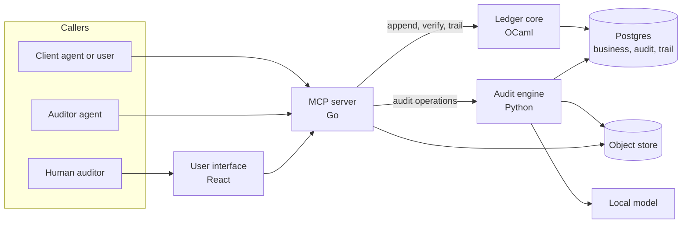

# Product Requirements Document

## Sanchay. PS 04: AI-Run Statutory Revenue Audit

| Field | Value |
|---|---|
| Product | Sanchay |
| Team | ELEV05 |
| Event | Elevate 1.0, DJSCE Institution's Innovation Council |
| Repository | https://github.com/ELEVATE-1-0/ELEV05 |
| Document version | 1.0 |
| Date | 2026-10-10 |
| Status | Baseline for build |
| Source documents | `Elevate 1.0 PS list.pdf` (pages 8 to 10), `ps4-revenue-audit-approach.md` |

This document is the single reference for what is built, how the parts connect, and who owns each part. Where it differs from the approach file, this document takes precedence. Section 25 lists those differences.

---

## Contents

1. Purpose and scope
2. Goals, non-goals and success measures
3. Design principles
4. Identities and permissions
5. System overview
6. System of record
7. Double-entry ledger
8. Ledger core service (OCaml)
9. MCP server (Go)
10. Audit engine (Python)
11. Related-party identification
12. Sampling
13. Detectors
14. Evidence verification
15. Findings model
16. Snapshot, tamper evidence and change detection
17. Concurrency model
18. End-to-end audit workflow
19. Outputs
20. User interface
21. Use of AI
22. Non-functional requirements
23. Synthetic data and self-test
24. Standards and framework references
25. Changes from the approach file
26. Repository layout, ownership and working conventions
27. Work split and milestones
28. Risks
29. Traceability to the problem statement
30. Glossary

---

## 1. Purpose and scope

### 1.1 Purpose

The product lets an AI agent run a statutory revenue audit of a mid-size manufacturer from start to finish. The agent holds only an identity. It audits the business itself, not an exported spreadsheet, and it cannot alter the business it audits.

### 1.2 In scope

| Area | Description |
|---|---|
| System of record | The full commercial life of a sale, from enquiry to settlement and reversal, plus the purchase side needed to expose circular trading. |
| Ledger | A double-entry ledger that is append-only and hash-chained. |
| MCP server | All capabilities exposed as Model Context Protocol tools, scoped by identity. |
| Audit engine | Register reconciliation, related-party identification, sampling, detectors and evidence verification. |
| Outputs | Audit workpaper (.xlsx), findings memo and tamper-evident audit trail. |
| User interface | A client view for uploads and a human auditor view for review and confirmation. |
| Self-test | Synthetic data with planted irregularities and a recall report. |

### 1.3 Out of scope

- Inventory valuation, payroll and fixed assets. The event model allows them later (see section 22.5).
- Live integration with the GST portal, e-way bill portal or banks. These are represented by records entered through client tools.
- Forming the audit opinion. The product supports the auditor and does not replace the signing partner.

### 1.4 Priority labels

| Label | Meaning |
|---|---|
| P0 | Required by the problem statement. The product is incomplete without it. |
| P1 | Strengthens detection or agent usability. Expected in the demo. |
| P2 | Brownie point named in the problem statement. |

---

## 2. Goals, non-goals and success measures

### 2.1 Goals

| ID | Goal |
|---|---|
| G-1 | Detect every irregularity category named in the problem statement (section 13). |
| G-2 | Make every sample selection reproducible and explained (section 12). |
| G-3 | Guarantee that an auditor identity cannot change business data (section 4). |
| G-4 | Detect any client change after testing begins and trace it to affected samples (section 16). |
| G-5 | Let an unfamiliar external agent complete the audit using only the MCP tools (section 9). |
| G-6 | Produce a workpaper in the layout auditors already use (section 19). |

### 2.2 Non-goals

- Preventing irregular transactions at entry. The system of record accepts commercially unusual events because the audit must be able to find them (principle P-6).
- Using a language model to decide what is a finding or which items are sampled.

### 2.3 Success measures

| Measure | Target |
|---|---|
| Recall per detector category on the self-test data | 100 percent |
| False positives on the clean baseline data | 0 |
| Same seed and same snapshot produce identical samples and findings | Always |
| Write attempts by an auditor identity that succeed | 0 |
| External agent completes the audit with no human hint | Yes, with at least two different agents |
| Bring-up from a clean checkout | One command |

---

## 3. Design principles

| ID | Principle | Enforced in |
|---|---|---|
| P-1 | Deterministic core, AI at the edges. No detector or sample depends on a model call. | Sections 12, 13, 21 |
| P-2 | Invalid states are unrepresentable. Unbalanced postings and auditor writes cannot be constructed. | Sections 7, 8 |
| P-3 | The auditor works on a frozen snapshot, defined by a ledger sequence number. | Section 16 |
| P-4 | Every finding carries lineage to the events, documents and rule that produced it. | Section 15 |
| P-5 | Nothing is cleaned silently. Every difference becomes a finding. | Sections 10, 13 |
| P-6 | The system of record rejects only structurally invalid events. It does not reject unusual business events. | Sections 6, 8 |
| P-7 | Nothing is updated or deleted. Corrections are new events. | Sections 7, 16 |
| P-8 | Every tool call by every identity is logged on a hash chain. | Section 16 |

---

## 4. Identities and permissions

### 4.1 Roles

| Role | Held by | Purpose |
|---|---|---|
| `client_employee` | AI agent or client user | Runs the business: creates records, uploads the register, responds to evidence requests. |
| `auditor` | AI agent (ours or the judges') | Runs the audit: reads the snapshot, samples, tests, raises findings, exports outputs. |
| `audit_manager` | Human auditor | Reviews findings and confirms or rejects each conclusion. Has every `auditor` capability. |

An identity is a bearer token that maps to exactly one role and one user name. The server reads the role from the token. A role is never accepted from tool arguments.

A `client_employee` identity may also belong to one department. The department narrows what that identity can change, so that duties inside the client are separated: no single department can take an order, ship it, bill it and collect on it. Reading stays open to every department, apart from the trial balance and the register export. An identity with no department is not restricted.

| Department | Owns |
|---|---|
| Sales | Customers, prices, promotions, enquiries, sales orders |
| Dispatch | Dispatches, e-way bills, lorry receipts, deliveries, sales returns, goods receipts, transport evidence |
| Accounts | Invoices, GSTR-1, receipts, bank statements, credit notes, reversals, purchase invoices, payments, journals, the register upload, evidence |
| Admin | Vendors, company officers, the related-party list, the register upload, evidence |

The MCP server enforces departments at the tool layer, for the interface and for agents alike. A refused call returns `PERMISSION_DENIED` and names the owning department, and `get_access_policy` returns the whole split. The ledger core records the user name of every event, so each step of a sale carries the person who performed it.

### 4.2 Permission matrix

| Capability | `client_employee` | `auditor` | `audit_manager` |
|---|---|---|---|
| Append business events (section 9.3) | Yes | No | No |
| Read current business records | Yes | No | No |
| Read snapshot of business records | No | Yes | Yes |
| Upload register, related-party list, evidence | Yes | No | No |
| Open engagement, sample, run detectors | No | Yes | Yes |
| Raise findings (status `proposed`) | No | Yes | Yes |
| Confirm or reject findings | No | No | Yes |
| Export workpaper and memo | No | Yes | Yes |
| Read audit trail | Own entries | All | All |

### 4.3 Enforcement layers

Each layer is sufficient on its own. A failure in one does not grant access.

| Layer | Mechanism | Owner |
|---|---|---|
| L1 Tool visibility | The MCP server lists only the tools of the caller's role. A call to another role's tool returns `PERMISSION_DENIED`. | MCP server |
| L2 Ledger capability | The ledger core issues a write capability only for `client_employee` requests. The auditor handle type has no append function. | Ledger core |
| L3 Database role | Each service connects with a Postgres role limited as in section 4.4. | Database |
| L4 Append-only triggers | `UPDATE` and `DELETE` raise an error on every table in every schema. | Database |

### 4.4 Database schemas and roles

| Schema | Contents | Written by |
|---|---|---|
| `business` | Event log, ledger postings, document views (section 6, 7) | Ledger core only |
| `audit` | Engagements, register imports, tags, samples, evidence results, findings, decisions (sections 10 to 15) | Audit engine |
| `trail` | Hash-chained log of every tool call (section 16.4) | Ledger core only |

| Postgres role | Used by | `business` | `audit` | `trail` |
|---|---|---|---|---|
| `ledger_rw` | Ledger core | INSERT, SELECT | none | INSERT, SELECT |
| `engine_audit` | Audit engine | SELECT | INSERT, SELECT | SELECT |
| `mcp_read` | MCP server | SELECT | SELECT | SELECT |

The audit engine reads the `business` schema directly for speed. For that path the binding control is the `engine_audit` role (L3), not the OCaml types (L2). The engine holds no credential that can write to `business`.

---

## 5. System overview

### 5.1 Components

| Component | Language | Responsibility | Owner |
|---|---|---|---|
| Ledger core | OCaml 5 | Sole writer of the business chain and trail chain. Posting rules, hash chain, Merkle roots, integrity verification. | Person A |
| MCP server | Go | Identity, role-scoped MCP tools, input validation, HTTP gateway for the UI, notifications. | Person A |
| Audit engine | Python | Reconciliation, related-party identification, sampling, detectors, evidence verification, workpaper and memo. | Person B |
| Data generator | Python | Synthetic business with planted irregularities and answer key. | Person B |
| User interface | React, Tailwind | Client view and auditor view. | Person A |
| Database | Postgres | Storage, schemas, roles, append-only triggers. | Person A (schema agreed by both) |
| File store | Shared volume, or MinIO | Evidence and uploaded files, addressed by SHA-256. A directory on a shared volume by default; MinIO or another S3-compatible store when `OBJECT_STORE=s3`. | Person A |
| Local model | Ollama | Evidence field extraction and wording only. | Person B |

### 5.2 Component diagram

### 5.3 Rules for communication

| Rule | Statement |
|---|---|
| C-1 | Callers reach the system only through the MCP server. The UI uses the same tool handlers over HTTP. There is no second path with separate logic. |
| C-2 | Only the ledger core writes to `business` and `trail`. |
| C-3 | Only the audit engine writes to `audit`. |
| C-4 | The MCP server holds no audit logic. Each auditor tool is a thin call to one engine endpoint. |
| C-5 | Services talk over HTTP with JSON bodies on an internal network. |
| C-6 | The only push channel is Server-Sent Events from the MCP server to the UI. WebSockets are not used. |

### 5.4 Service endpoints

| Service | Internal address | Exposed to host |
|---|---|---|
| MCP server | `mcp:8080` (`/mcp` for MCP, `/api` for the UI) | 8080 |
| Ledger core | `ledger:7001` | No |
| Audit engine | `engine:7002` | No |
| User interface | `ui:5173` | 5173 |
| Postgres | `db:5432` | No |
| File store | Volume `files`, or `minio:9000` | No |
| Local model | `ollama:11434` | No |

---

## 6. System of record

### 6.1 Modelling approach

Every change to the business is an immutable event in `business.events`. Documents are read through views that select events by type. A document is never edited. A correction is a `DocumentReversed` event followed by a new document (principle P-7).

Each event carries the common fields below.

| Field | Description |
|---|---|
| `seq` | Global sequence number, gap-free, assigned by the ledger core. |
| `event_type` | One of the types in section 6.3. |
| `entity_id` | Legal entity that owns the event. Supports multi-entity consolidation. |
| `aggregate_type` | Kind of document or master record, for example `invoice`. |
| `aggregate_id` | The document or master record the event belongs to. |
| `aggregate_version` | Version of that aggregate after this event. |
| `sale_id` | Links all events of one sale. Null for events that are not part of a sale. |
| `payload` | Event data as JSON. |
| `business_date` | The date the event states for itself, for example invoice date. |
| `recorded_at` | Server time when the event was appended. |
| `identity` | User name and role that caused the event. |
| `idempotency_key` | Key supplied by the caller. |
| `prev_hash`, `hash` | Chain fields (section 8.3). |

`business_date` and `recorded_at` are kept separate. A gap between them is evidence of backdating (detector D-14).

### 6.2 What must exist to prove a sale

| Stage in the problem statement | Records | Proves |
|---|---|---|
| First customer interaction | Enquiry | A real customer asked for goods. |
| Commitment and pricing | Sales order, price list, promotion | Agreed quantity, rate, discount, delivery terms and approver. |
| Physical movement | Dispatch, e-way bill, lorry receipt, proof of delivery | Goods left the premises and reached the customer. |
| Revenue and tax recognition | Invoice, GSTR-1 line, ledger posting | Revenue and tax were recognised and reported to the tax authority. |
| Cash settlement | Receipt, bank statement line | The customer paid from its own account. |
| Promotions | Promotion, discount on order and invoice | Discounts follow an approved scheme. |
| Reversal | Credit note, sales return | Revenue was later reduced and goods came back. |
| Parties | Customer, vendor, company officer | Who the counterparty is and who it is linked to. |
| Purchase side | Purchase invoice, goods receipt, payment | Goods and money flowing back, needed to detect cycles. |

### 6.3 Event catalogue

| Event type | Created by tool | Key payload fields | Ledger posting |
|---|---|---|---|
| `CustomerCreated` | `create_customer` | name, GSTIN, PAN, addresses, phone, email, bank accounts, directors, effective_from | None |
| `CustomerUpdated` | `update_customer` | changed fields, effective_from | None |
| `VendorCreated` | `create_vendor` | same fields as customer | None |
| `VendorUpdated` | `update_vendor` | changed fields, effective_from | None |
| `CompanyOfficerRecorded` | `record_company_officer` | name, PAN, DIN, role, phone, email, address, effective_from, effective_to | None |
| `PriceSet` | `set_price` | item, rate, effective_from | None |
| `PromotionCreated` | `create_promotion` | scheme id, discount percent, valid_from, valid_to, eligible customers, approver | None |
| `EnquiryRecorded` | `record_enquiry` | customer, date, channel, items | None |
| `SalesOrderCreated` | `create_sales_order` | customer, items, qty, rate, discount, scheme id, delivery terms, approver | None |
| `DispatchRecorded` | `record_dispatch` | order, date and time, qty, vehicle no., from and to address | None |
| `EWayBillGenerated` | `generate_eway_bill` | e-way bill no., invoice no., value, GSTINs, vehicle no., distance km, valid_until | None |
| `LorryReceiptRecorded` | `record_lr` | LR no., transporter, vehicle no., date, consignee | None |
| `DeliveryRecorded` | `record_delivery` | delivery date and time, receiver, POD reference | None |
| `InvoiceIssued` | `issue_invoice` | invoice no., date, customer, items, taxable value, discount, packing, freight, insurance, CGST, SGST, IGST, TCS, round-off, gross, place of supply, IRN | Yes |
| `Gstr1Filed` | `file_gstr1` | return period, lines (invoice no., GSTIN, taxable value, tax by type, place of supply) | None |
| `ReceiptRecorded` | `record_receipt` | invoice refs, amount, date, payer name, payer account, UTR | Yes |
| `BankStatementImported` | `import_bank_statement` | lines (date, amount, direction, counterparty name, counterparty account, UTR) | None |
| `CreditNoteIssued` | `issue_credit_note` | credit note no., date, original invoice, reason, taxable value, tax, approver | Yes |
| `SalesReturnRecorded` | `record_sales_return` | credit note ref, inward date, qty, vehicle no. | None |
| `PurchaseInvoiceRecorded` | `record_purchase_invoice` | vendor, invoice no., date, items, taxable value, tax | Yes |
| `GoodsReceiptRecorded` | `record_goods_receipt` | purchase ref, date, qty, vehicle no. | None |
| `PaymentMade` | `record_payment` | vendor, amount, date, payee account, UTR | Yes |
| `JournalPosted` | `post_journal` | date, narration, lines (account, debit, credit), approver | Yes |
| `DocumentReversed` | `reverse_document` | target aggregate, reason | Yes, if the target posted |
| `SalesRegisterUploaded` | `upload_sales_register` | file hash, file name, row count, period | None |
| `RelatedPartyListUploaded` | `upload_related_parties` | file hash, parties (name, PAN or GSTIN, relationship, effective_from) | None |
| `EvidenceUploaded` | `upload_evidence` | sample id, document type, file hash | None |

### 6.4 Structural validation (the only rejections)

The ledger core rejects an event only in these cases. Everything else is accepted (principle P-6).

| Code | Condition |
|---|---|
| `UNKNOWN_REFERENCE` | The event refers to an aggregate that does not exist. |
| `VERSION_CONFLICT` | `expected_version` does not match the aggregate's current version. |
| `UNBALANCED_POSTING` | Debits do not equal credits. |
| `INVALID_TRANSITION` | The transition is impossible, for example reversing a document twice. |
| `NOT_PERMITTED` | The caller does not hold a write capability. |

The following are accepted by design, because they are what the audit detects: an invoice with no order or dispatch, an invoice dated before its recording date, a discount with no promotion, a journal that credits Sales, a receipt from a third-party account, and a credit note after period end.

### 6.5 Sale lifecycle

A sale normally moves through `Enquired`, `Ordered`, `Dispatched`, `Delivered`, `Invoiced`, `Settled`, and may end in `Reversed`. The state is derived from the events present for a `sale_id`. It is not a gate. Missing or out-of-order stages are reported by detector D-05.

---

## 7. Double-entry ledger

### 7.1 Chart of accounts

| Code | Account | Type |
|---|---|---|
| 1000 | Bank | Asset |
| 1100 | Trade Receivables | Asset |
| 1300 | GST Input Credit | Asset |
| 2000 | Trade Payables | Liability |
| 2100 | CGST Output | Liability |
| 2101 | SGST Output | Liability |
| 2102 | IGST Output | Liability |
| 2200 | TCS Payable | Liability |
| 4000 | Sales Revenue | Income |
| 4100 | Sales Returns and Credit Notes | Income (contra) |
| 4200 | Freight, Packing and Insurance Recovered | Income |
| 4900 | Round-off | Income |
| 5000 | Purchases | Expense |
| 9000 | Suspense | Other |

### 7.2 Posting rules

Postings are derived by the ledger core from the event. The caller does not supply them, except for `JournalPosted`.

| Event | Debit | Credit |
|---|---|---|
| `InvoiceIssued` | 1100 gross | 4000 taxable value, 4200 packing, freight and insurance, 2100, 2101, 2102 tax by type, 2200 TCS, 4900 round-off |
| `ReceiptRecorded` | 1000 amount | 1100 amount |
| `CreditNoteIssued` | 4100 taxable value, 2100, 2101, 2102 tax by type | 1100 gross |
| `PurchaseInvoiceRecorded` | 5000 taxable value, 1300 tax | 2000 gross |
| `PaymentMade` | 2000 amount | 1000 amount |
| `JournalPosted` | Lines as supplied | Lines as supplied |
| `DocumentReversed` | Mirror of the target's credits | Mirror of the target's debits |

### 7.3 Ledger requirements

| ID | Requirement | Priority |
|---|---|---|
| LG-1 | Every posting row stores `seq`, account, debit, credit, `sale_id` and `source_event_type`. | P0 |
| LG-2 | For every event, total debits equal total credits. | P0 |
| LG-3 | Amounts are stored as integers in paise. No floating point is used for money. | P0 |
| LG-4 | A posting to account 4000 whose `source_event_type` is not `InvoiceIssued` is permitted and is visible to detector D-09. | P0 |
| LG-5 | A trial balance can be produced as at any sequence number. | P1 |

---

## 8. Ledger core service (OCaml)

### 8.1 Role

The ledger core is the only writer of the business chain and the trail chain. It uses OCaml for two reasons: the type system makes invalid postings and auditor writes unrepresentable, and Eio with Domains gives a single-writer sequencer with parallel verification.

### 8.2 Requirements

| ID | Requirement | Priority |
|---|---|---|
| LC-1 | A posting set is built only through a constructor that returns an error unless debits equal credits. | P0 |
| LC-2 | Posting rules (section 7.2) are a total function over the event type variant. A new event type does not compile until its rule is written. | P0 |
| LC-3 | Two capability types exist. `client_cap` exposes append. `auditor_cap` exposes only reads. No function converts one to the other. | P0 |
| LC-4 | One Eio fiber owns each chain. All append requests go through a mailbox to that fiber. | P0 |
| LC-5 | The sequencer checks the idempotency key, checks `expected_version`, assigns `seq`, computes the hash and inserts the event and its postings in one database transaction. | P0 |
| LC-6 | A repeated idempotency key with the same payload returns the original result. With a different payload it returns `IDEMPOTENCY_MISMATCH`. | P0 |
| LC-7 | A Merkle root over the event hashes of each calendar day is stored when the day closes and on demand. | P1 |
| LC-8 | Full-chain verification splits the chain into segments and verifies them in parallel across Domains. | P1 |
| LC-9 | The trail chain uses the same sequencer code with its own head. | P0 |

### 8.3 Hash chain

- `hash_n = SHA256(hash_(n-1) || canonical_json(event_n))`.
- The genesis `prev_hash` is 64 zero characters.
- `canonical_json` sorts keys, uses no insignificant whitespace and encodes amounts as integers.
- The hashed content excludes `hash` itself and includes every other field in section 6.1.

### 8.4 Service API

| Method and path | Request | Response | Used by |
|---|---|---|---|
| `POST /append` | event_type, entity_id, aggregate_id, expected_version, sale_id, payload, business_date, identity, idempotency_key | `seq`, `hash`, `aggregate_version`, or an error code from section 6.4 | MCP server |
| `GET /head` | none | `seq`, `hash` | MCP server, engine |
| `GET /verify?from=&to=` | sequence range | `ok`, `first_bad_seq`, `head_hash` | MCP server |
| `GET /merkle/{date}` | date | `root`, `first_seq`, `last_seq` | MCP server |
| `GET /proof/{seq}` | sequence number | Merkle path for that event | MCP server |
| `POST /trail/append` | identity, tool, args_hash, result_hash, engagement_id | `trail_seq`, `hash` | MCP server |
| `GET /trail/verify` | none | `ok`, `first_bad_seq` | MCP server |

---

## 9. MCP server (Go)

### 9.1 Transport and identity

| ID | Requirement | Priority |
|---|---|---|
| MS-1 | The server speaks MCP over Streamable HTTP at `/mcp`. A stdio mode is available for local agents. | P0 |
| MS-2 | The caller presents a bearer token. The server resolves it to user name and role (section 4.1). | P0 |
| MS-3 | `tools/list` returns only the tools of the caller's role. | P0 |
| MS-4 | Every tool call, including failed and denied calls, is appended to the trail chain (section 16.4). | P0 |
| MS-5 | The same handlers are served under `/api` for the UI (rule C-1). | P0 |

### 9.2 Tool conventions

| ID | Convention |
|---|---|
| TC-1 | Names are verb then noun in snake case. |
| TC-2 | Each description states when to call the tool, what it needs first and what to call next. |
| TC-3 | Every write tool requires `idempotency_key`. Repeating a call is safe (LC-6). |
| TC-4 | List results are paginated with `limit` and `cursor`, and return compact rows with IDs usable in the next tool. |
| TC-5 | Errors return a code, a message and a `next_step` that tells the agent how to recover. |
| TC-6 | Auditor tools that depend on an earlier step run that step automatically when it is deterministic, and report that they did so. |
| TC-7 | Every auditor tool takes `engagement_id`. If only one engagement is open it is used by default. |

Error codes: `PERMISSION_DENIED`, `NO_ENGAGEMENT`, `NOT_FOUND`, `VALIDATION_FAILED`, `IDEMPOTENCY_MISMATCH`, `EVIDENCE_PENDING`, and the ledger codes in section 6.4.

Example: `{"code": "NO_ENGAGEMENT", "message": "No engagement is open.", "next_step": "Call open_engagement with period_start and period_end."}`

### 9.3 Client-employee tools

Each tool below appends the event named in section 6.3.

| Group | Tools |
|---|---|
| Parties | `create_customer`, `update_customer`, `create_vendor`, `update_vendor`, `record_company_officer` |
| Pricing and promotions | `set_price`, `create_promotion` |
| Sale | `record_enquiry`, `create_sales_order`, `record_dispatch`, `generate_eway_bill`, `record_lr`, `record_delivery`, `issue_invoice` |
| Tax | `file_gstr1` |
| Settlement | `record_receipt`, `import_bank_statement` |
| Reversal | `issue_credit_note`, `record_sales_return`, `reverse_document` |
| Purchases | `record_purchase_invoice`, `record_goods_receipt`, `record_payment` |
| General ledger | `post_journal` |
| Audit support | `upload_sales_register`, `upload_related_parties`, `list_evidence_requests`, `upload_evidence` |
| Read | `get_record`, `list_records`, `export_sales_register` |

`export_sales_register` produces a register in the client layout (section 10.2) from the current records. It lets a client agent generate the file it then uploads.

### 9.4 Auditor tools

| Step | Tool | Purpose | Engine endpoint |
|---|---|---|---|
| 0 | `get_audit_plan` | Returns the ordered steps in this table with the current status of each. | `GET /plan` |
| 1 | `get_notifications` | Lists client uploads and evidence responses not yet seen. | none (MCP server) |
| 2 | `open_engagement` | Freezes the snapshot for a period and seed. | `POST /engagements` |
| 3 | `import_register` | Copies the client register into the workpaper exactly as provided. | `POST /register/import` |
| 4 | `reconcile_register` | Compares register and system of record. Raises findings. | `POST /register/reconcile` |
| 5 | `tag_related_parties` | Tags each customer and suggests undisclosed related parties. | `POST /related-parties/tag` |
| 6 | `run_detectors` | Runs all population-level detectors on the snapshot. | `POST /detectors/run` |
| 7 | `select_sales_tod` | Selects 25 to 35 risk-weighted samples with reasons. | `POST /samples/sales` |
| 8 | `select_cutoff_tod` | Selects invoices around the period end. | `POST /samples/cutoff` |
| 9 | `select_credit_note_tod` | Selects credit notes, weighted to those after period end. | `POST /samples/credit-notes` |
| 10 | `get_evidence_status` | Shows which requested documents the client has uploaded. | `GET /evidence/status` |
| 11 | `verify_evidence` | Tests uploaded evidence for one sample or all samples. | `POST /evidence/verify` |
| 12 | `check_post_testing_changes` | Lists client changes after the snapshot that touch samples. | `POST /changes/check` |
| 13 | `verify_ledger_integrity` | Recomputes both chains and compares the snapshot head. | ledger core, then `POST /integrity/report` |
| 14 | `get_findings` | Lists findings with filters. | `GET /findings` |
| 15 | `explain_finding` | Returns lineage and a plain-language reason for one finding. | `GET /findings/{id}/explain` |
| 16 | `draft_findings_memo` | Produces the findings memo. | `POST /memo` |
| 17 | `export_workpaper` | Produces the .xlsx workpaper. | `POST /workpaper` |

Supporting read tools, usable at any step after step 2:

| Tool | Purpose |
|---|---|
| `get_engagement_status` | Period, seed, snapshot sequence, steps completed, next recommended tool. |
| `query_records` | Reads documents of one type from the snapshot with filters. |
| `get_sale_chain` | Returns every event of one `sale_id` in order. |
| `get_ledger_entries` | Reads postings by account, date range or `sale_id`. |
| `get_counterparty_graph` | Returns nodes, edges and detected cycles (section 13, D-04). |
| `request_evidence` | Requests additional documents for a sample. |
| `get_audit_trail` | Reads trail entries with the integrity result. Exports the trail as a file on request. |
| `get_merkle_proof` | Proves that one event belongs to its day's Merkle root. |
| `list_engagements`, `get_register_rows`, `get_samples` | Read stored engagements, register rows and samples. Used by the UI. |

Steps 7 to 9 create evidence requests automatically and notify the client. `request_evidence` is only for follow-up requests.

### 9.5 Audit-manager tools

All tools in section 9.4, plus:

| Tool | Purpose |
|---|---|
| `confirm_finding` | Records `confirmed`, `rejected` or `needs_info` with a note for one finding. |
| `sign_off_engagement` | Records that all findings have a decision and closes the engagement. |

`confirm_finding` is not available to the `auditor` role. An agent cannot confirm its own conclusions. Outputs can be exported before confirmation, with each unconfirmed finding marked `Pending auditor confirmation`.

### 9.6 Notifications

| ID | Requirement | Priority |
|---|---|---|
| NT-1 | When `SalesRegisterUploaded`, `RelatedPartyListUploaded` or `EvidenceUploaded` is appended, a notification for the auditor side is created. | P0 |
| NT-2 | When samples are selected, a notification for the client side is created with the list of requested documents. | P0 |
| NT-3 | Notifications are available through `get_notifications`, `list_evidence_requests` and a Server-Sent Events stream to the UI at `/api/stream`. Agents poll the two tools and need no push channel. | P0 |
| NT-4 | Each tool call is reported on the stream to the audit side with a `changes` flag. The flag is true only for a call that changed a client record or completed an audit step. A screen reloads on a change and never on a read, so two auditors on one engagement cannot reload each other. | P0 |

---

## 10. Audit engine (Python)

### 10.1 Engagement

| ID | Requirement | Priority |
|---|---|---|
| EN-1 | `open_engagement` takes `period_start`, `period_end`, optional `seed` and optional `entity_ids`. The period end is not fixed to 31 March. | P0 |
| EN-2 | It records `snapshot_seq` and `snapshot_hash` from the ledger head and the Merkle root at that point. | P0 |
| EN-3 | If no seed is given, the engine generates one, stores it and returns it. | P0 |
| EN-4 | Every later read of `business` by the engine filters on `seq <= snapshot_seq`, except change detection (section 16.3) and evidence intake. | P0 |
| EN-5 | Opening an engagement requires a `SalesRegisterUploaded` and a `RelatedPartyListUploaded` event at or before the snapshot. Otherwise it returns an error naming the missing upload. | P0 |

### 10.2 Register import

The client register follows the layout in Fig. 1 of the problem statement.

| Column | Meaning |
|---|---|
| Bill no. | Invoice number |
| Date | Invoice date |
| Job No. | Order or job reference |
| Customer | Customer name |
| Ledger Account | Sales ledger account |
| State Code | Place of supply state code |
| GST No. | Customer GSTIN |
| Total Cost | Taxable value |
| Discount, Packing, Freight, Insurance | Adjustments and recoveries |
| IGST, CGST, SGST | Tax by type |
| TCS Collection | Tax collected at source |
| Round | Round-off |
| Gross Amt. | Invoice total |
| Tax | Tax rate description |
| BU | Business unit |
| E Invoice | E-invoice status |

| ID | Requirement | Priority |
|---|---|---|
| RI-1 | The file is read from the object store by the hash in the upload event. The stored file is never modified. | P0 |
| RI-2 | Every row and every cell is copied as provided: same order, same values, no trimming, no type conversion, no removal of duplicates or blanks. | P0 |
| RI-3 | Columns are matched by header name, in any order. Unrecognised columns are kept. A missing expected column is a finding of category `REGISTER_MISMATCH`. | P0 |
| RI-4 | Parsed values used for comparison are stored beside the raw values, not in place of them. | P0 |
| RI-5 | Accepted formats are .xlsx and .csv. | P0 |

### 10.3 Register reconciliation

Reconciliation compares the register rows with the invoices in the snapshot whose invoice date falls in the period. Every difference is a finding (principle P-5). The findings belong to detector D-01.

| Check | Finding subtype |
|---|---|
| Invoice in the system of record, absent from the register | `MISSING_IN_REGISTER` |
| Row in the register, no such invoice in the system of record | `NOT_IN_SYSTEM` |
| Same invoice number, different date, customer, GSTIN, taxable value, tax or gross | `FIELD_DIFFERENCE` (one finding per invoice, listing each field) |
| Same invoice number more than once in the register | `DUPLICATE_ROW` |
| Register row arithmetic does not foot (components do not sum to gross) | `ROW_ARITHMETIC` |
| Register total differs from net credits to account 4000 for the period | `TOTAL_NOT_AGREED_TO_LEDGER` |
| Reversed invoice still present in the register | `REVERSED_IN_SYSTEM` |

The reconciliation status of each row is written to the Sales Register sheet (section 19.1).

---

## 11. Related-party identification

### 11.1 Inputs

- The disclosed list from `RelatedPartyListUploaded`.
- Customer and vendor master events, including effective dates.
- Company officers from `CompanyOfficerRecorded`.
- Payer accounts from receipts and bank statement lines.

### 11.2 Tagging

| Tag | Rule | Shown in workpaper as |
|---|---|---|
| Related (disclosed) | The customer matches a disclosed party by PAN, GSTIN or exact normalised name. | `Related Party` |
| Related (suggested) | The customer is linked by the resolver in section 11.3 and is not disclosed. | `Non Related Party`, with `Suggested RP` filled |
| Non-related | Neither of the above. | `Non Related Party` |

The `Related / Non Related` column follows the disclosed list, as the core problem statement requires. Suggested links are never merged into that column. They appear in a separate column and each one is a finding from detector D-02. Sampling treats both disclosed and suggested parties as related (section 12.2).

### 11.3 Entity resolution

| Signal | Rule | Strength |
|---|---|---|
| Same PAN | PAN is characters 3 to 12 of the GSTIN. Two GSTINs with the same PAN are the same legal person. | Strong |
| Shared director | Same PAN or DIN among directors or company officers. | Strong |
| Shared bank account | Same account on two masters, or a receipt paid from an account held by another party or an officer. | Strong |
| Shared phone or email | Exact match after normalisation. | Medium |
| Shared address | Normalised address match with Jaro-Winkler similarity of 0.92 or more. | Medium |
| Similar name | Jaro-Winkler similarity of 0.92 or more after removing legal suffixes. | Weak |

One strong signal, or two medium signals, or one medium and one weak signal, creates a link. Links are joined into clusters with union-find. A cluster that contains the company, an officer or a disclosed related party marks every other member as a suggested related party. Each suggestion lists the signals behind it.

### 11.4 Relationships that begin partway through the period

| ID | Requirement | Priority |
|---|---|---|
| RP-1 | Every link carries the `effective_from` of the master version or officer record that created it. | P0 |
| RP-2 | A customer is related only for sales dated on or after the link's `effective_from`. | P0 |
| RP-3 | Where a link starts inside the period, the output shows sales before and after the start date separately. This is detector D-03. | P0 |
| RP-4 | A disclosed party whose disclosed start date is later than the first resolved link is reported as late disclosure. | P1 |

---

## 12. Sampling

### 12.1 Reproducibility

| ID | Requirement | Priority |
|---|---|---|
| SM-1 | Selection uses no model call and no wall-clock value. | P0 |
| SM-2 | The random generator is seeded with `SHA256(seed || snapshot_seq || sheet_name)`. | P0 |
| SM-3 | The population is sorted by invoice number before any selection step. | P0 |
| SM-4 | The same seed and snapshot always give the same samples in the same order. | P0 |
| SM-5 | Each sample stores a `reason` built from the rule codes that selected it. | P0 |
| SM-6 | Seed, snapshot sequence, snapshot hash, population size and stratum counts are written to the workpaper (section 19.1). | P0 |
| SM-7 | Calling a selection tool again returns the stored samples. It does not reselect. | P0 |

### 12.2 Sales TOD

Population: invoices in the period from the snapshot, plus register rows with subtype `NOT_IN_SYSTEM`. Target size: 30, bounded to 25 to 35.

Risk score per item:

| Factor | Points |
|---|---|
| Customer is a disclosed related party | 30 |
| Customer is a suggested related party | 35 |
| Amount at or above the 95th percentile | 20 |
| Invoice dated in the last 10 days of the period | 15 |
| Each population-level detector hit on the item (D-01, D-05, D-06, D-08, D-12, D-13, D-14) | 15 each, capped at 45 |
| Indicator hit (section 13.3) | 5 |

Selection steps, applied in order until the target is reached:

| Step | Rule | Reason code |
|---|---|---|
| 1 | The 5 largest items by taxable value. | `KEY_ITEM` |
| 2 | The highest-scored item of each related-party customer, up to 10. | `RELATED_PARTY` |
| 3 | The highest-scored item for each detector category that has hits. | `DETECTOR_HIT` |
| 4 | One item for each of the 10 largest customers not yet covered. | `CUSTOMER_COVERAGE` |
| 5 | Remaining slots by monetary-unit sampling with a seeded random start, weighted by taxable value multiplied by (1 + score / 100), spread across quarters and business units. | `MUS` |

The final sample must include related and non-related parties and at least 8 distinct customers where the population allows. A sample can carry more than one reason code.

Example reason: `RELATED_PARTY (suggested: shared bank account with director); KEY_ITEM (rank 3 by value); 2 days before period end.`

Tests applied to each sample, matching the work steps in Fig. 2:

| Test | Passes when |
|---|---|
| Occurrence | Order, dispatch, e-way bill, LR and delivery exist and agree with the invoice. |
| Amount | Invoice value agrees with the ledger posting and the evidence. |
| Party | Customer on the invoice, evidence and receipt payer agree. |
| Ledger account | Revenue is posted to account 4000 from an `InvoiceIssued` event. |
| Period | Transfer of control falls in the period in which revenue is recognised (D-06). |
| Tax | Tax type and amount agree with place of supply and GSTR-1 (D-08). |
| Evidence | Uploaded documents pass section 14. |

Each test result is `Pass`, `Exception` or `Pending evidence`.

### 12.3 Sales Cut-off TOD

| ID | Requirement | Priority |
|---|---|---|
| CO-1 | Select the last 10 invoices dated on or before `period_end`, ordered by date then invoice number. | P0 |
| CO-2 | Select the first 15 invoices dated after `period_end`. The count is configurable from 10 to 15. | P0 |
| CO-3 | The selection is fully determined by the snapshot. The seed is recorded but not used. | P0 |
| CO-4 | For each item, show invoice date, dispatch date, delivery date, delivery terms, control date, ledger posting date, period recognised, correct period and conclusion. | P0 |
| CO-5 | Control date follows section 13, D-06. | P0 |

### 12.4 Credit Note TOD

| ID | Requirement | Priority |
|---|---|---|
| CN-1 | Select every credit note dated after `period_end` against an invoice in the period, up to 15, largest first. | P0 |
| CN-2 | Fill up to a total of 20 with in-period credit notes, by monetary-unit sampling weighted to related parties and to the last month of the period. | P0 |
| CN-3 | For each item, show original invoice, reason, approver, sales return inward date, time from invoice to credit note, and conclusion. | P0 |

### 12.5 Sealed seed

A seed that someone picks can be picked again. An auditor, or an agent acting as one, could open engagements until the samples happen to miss the problem invoices. The seed is therefore fixed by a secret that neither side chooses and neither side can change.

| ID | Requirement | Priority |
|---|---|---|
| SS-1 | When the client uploads the sales register, the engine draws a secret of 32 random bytes and stores it against that upload. `upload_sales_register` returns `sampling_commitment`, the SHA-256 of the secret. The client holds the commitment before the auditor has read the register. | P0 |
| SS-2 | `open_engagement` with no `seed` derives it: the first 16 hexadecimal characters of `SHA256(secret | snapshot_hash)`. | P0 |
| SS-3 | The same register upload and snapshot always give the same seed and the same engagement. Opening again returns the engagement that exists. It does not draw again. | P0 |
| SS-4 | `verify_sampling_seal` is available to every role. Before an engagement opens it returns the commitment only. After, it returns the secret, the seed and the result of recomputing both hashes. | P0 |
| SS-5 | A `seed` passed to `open_engagement` is still accepted, for reproducing an earlier run. The engagement is then reported as `chosen`, in the status and by `verify_sampling_seal`. | P0 |
| SS-6 | If no seal exists when the engagement opens, one is made then and reported as `sealed at opening`. It still prevents a second draw, but the client did not hold the commitment first. | P1 |

---

## 13. Detectors

### 13.1 Rules common to all detectors

| ID | Requirement |
|---|---|
| DT-1 | Detectors read only the snapshot (EN-4), except D-15 and D-16. |
| DT-2 | Detectors are pure functions of the snapshot and the engagement parameters. |
| DT-3 | Each hit produces a finding in the format of section 15, with lineage. |
| DT-4 | A finding ID is a hash of engagement, category and subject. Running a detector twice does not create duplicates. |
| DT-5 | Detectors run in parallel. No detector depends on another detector's output, except that sampling reads detector hits. |
| DT-6 | Thresholds are held in one configuration file and are written to the workpaper. |

### 13.2 Detector catalogue

| ID | Category code | Problem statement requirement | Rule | Priority |
|---|---|---|---|---|
| D-01 | `REGISTER_MISMATCH` | Every difference between the register and the system of record is a finding. | Section 10.3. | P0 |
| D-02 | `RP_UNDISCLOSED` | Related parties may be undisclosed or linked only through shared identifiers. | Section 11.3. One finding per suggested party with the signals and the sales value involved. | P0 |
| D-03 | `RP_MID_PERIOD` | Related parties may begin partway through the period. | Section 11.4. | P0 |
| D-04 | `CIRCULAR_TRADING` | Circular trading. Counterparty graph exposing cycles. | Section 13.4. | P0 |
| D-05 | `NO_MOVEMENT` | Turnover with no physical movement behind it. | For each invoice, require dispatch, LR and delivery, and an e-way bill where the consignment value exceeds Rs 50,000. Report each missing or contradictory link, quantity mismatches, and invoices with no order. | P0 |
| D-06 | `CUTOFF` | Period allocation follows transfer of control, not invoice date. | Control date is the dispatch date for ex-works terms and the delivery date for delivered terms. Report when the control date and the recognition date fall in different periods, in either direction. | P0 |
| D-07 | `PERIOD_END_CONCENTRATION` | Period-end concentration of sales and discounts. | Compare sales value and average discount percent in the last 10 days of the period with the daily baseline of the rest of the period, overall and per customer. Report when the z-score is 3 or more. Raise severity where the same customer has post-period credit notes or returns. | P0 |
| D-08 | `DOC_TAX_MISMATCH` | Inconsistencies across statutory documents and tax filings. | Compare invoice, e-way bill and GSTR-1 line on value, GSTIN, place of supply and tax type. Report invoices absent from GSTR-1, GSTR-1 lines with no invoice, GSTIN with invalid structure or checksum, IGST charged on an intra-state supply or CGST and SGST on an inter-state supply, and GSTR-1 period total differing from the ledger. | P0 |
| D-09 | `NON_SALE_REVENUE` | Revenue entries that did not originate from a sale. | Report every credit to account 4000 whose source is not `InvoiceIssued`, or whose `sale_id` is null, or whose matching debit is not account 1100. | P0 |
| D-10 | `EVIDENCE_SUSPECT` | Evidence that is forged or belongs to another transaction. | Section 14. | P0 |
| D-11 | `CREDIT_NOTE` | Credit notes, especially those issued after the period end, are tested. | Report credit notes dated after `period_end` against in-period invoices, credit notes with no sales return, credit notes to related parties, credit notes with no approver, and credit notes that reverse most of a period-end invoice. | P0 |
| D-12 | `PROMOTION_DISCOUNT` | Promotions that drive demand. | Report discounts with no scheme, above the scheme rate, outside the scheme dates, to an ineligible customer, or below the price list rate with no approver. | P1 |
| D-13 | `SETTLEMENT` | Cash settlement. Supports bogus sale and cycle detection. | Report receipts with no matching bank statement line, receipts paid from an account that is not the customer's, receipts followed by a payment of a similar amount to a linked party within 7 days, and period-end invoices unpaid at the snapshot date beyond 90 days. | P1 |
| D-14 | `DOCUMENT_INTEGRITY` | Paperwork that looks complete but is not. | Report gaps and duplicates in the invoice number series, invoices whose `business_date` is more than 3 days before `recorded_at`, invoice numbers out of date order, one e-way bill or LR number used for more than one invoice, one vehicle on overlapping trips, and delivery faster than distance allows. | P1 |
| D-15 | `POST_TESTING_CHANGE` | Any client change after testing begins must be detected and traced to samples. | Section 16.3. | P0 |
| D-16 | `LEDGER_INTEGRITY` | A ledger that cannot be silently altered. | Section 16.2. Report any break in either chain. | P0 |

### 13.3 Indicators

Indicators are weak signals. They add to the sampling risk score (section 12.2) and are listed in the workpaper. They are not findings on their own.

| Indicator | Rule |
|---|---|
| Round amounts | Taxable value is an exact multiple of Rs 10,000. |
| First-digit distribution | A customer's invoice amounts deviate from the Benford distribution with mean absolute deviation above 0.015, with at least 100 invoices. |
| Just below threshold | Consignment value between Rs 45,000 and Rs 50,000, below the e-way bill threshold. |

### 13.4 Counterparty graph and cycles (D-04)

| Element | Definition |
|---|---|
| Node | A resolved entity cluster from section 11.3, so that a customer and a vendor under common control are one node. The company and each group entity are nodes. |
| Goods edge | From seller to buyer, from sales invoices and purchase invoices, with value and dates. |
| Money edge | From payer to payee, from receipts, payments and bank statement lines. |
| Cycle | A closed path of goods edges or money edges that returns to the company or a group entity. |

Method: find strongly connected components with Tarjan's algorithm, then list elementary cycles inside each component with Johnson's algorithm, limited to length 6.

A cycle is reported when its edges fall within a 60-day window and the smallest edge value is at least 80 percent of the largest. Each finding lists the path, the documents on each edge, the amounts and the dates. `get_counterparty_graph` returns the same data for the Graph tab (section 20).

---

## 14. Evidence verification

### 14.1 Flow

1. Sample selection creates an evidence request for each sample: invoice copy, e-way bill and LR copy for Sales TOD and Cut-off TOD, and credit note copy and return document for Credit Note TOD.
2. The client answers each request through `upload_evidence`, with the file or with a statement that no such document exists (section 14.4). Each file is stored by its SHA-256 hash, and each answer is recorded as an `EvidenceUploaded` event.
3. `verify_evidence` runs the checks below and updates the sample test results (section 12.2).

### 14.2 Extraction

| ID | Requirement | Priority |
|---|---|---|
| EV-1 | Text is extracted with OCR. Text PDFs are read directly. | P0 |
| EV-2 | Fields are extracted into a fixed schema per document type by the local model. | P1 |
| EV-3 | If the model is unavailable, fields are extracted with pattern rules for invoice number, GSTIN, dates, amounts, vehicle number, e-way bill number and LR number. | P0 |
| EV-4 | Each field has a confidence value. Below 0.8 the sample is marked `Needs human review`. It never passes silently. | P0 |
| EV-5 | Results are cached by file hash. | P1 |
| EV-6 | Hindi and Marathi documents are supported with the same schema and the same checks. A document in Devanagari is first rewritten with English labels and ASCII digits, and the fields are then extracted as for an English document. Scans use the OCR language packs. | P2 |
| EV-6a | A Devanagari label is matched to a dictionary of Hindi and Marathi wordings by its consonants, because the text layer of a Devanagari PDF is rarely exact. The kind of value on the line (date, GSTIN, amount, vehicle number) narrows the match. A label that cannot be placed leaves its field empty, so that EV-4 sends the sample to human review. Nothing is guessed. | P2 |
| EV-6b | The language each document was read in is stored with its extraction result, shown with the sample, and counted in the summary report. | P2 |

### 14.3 Checks

| ID | Check | Detects |
|---|---|---|
| E-1 | Extracted invoice number, date, customer, GSTIN and amounts agree with the system of record. | Altered or wrong document |
| E-2 | Invoice, e-way bill and LR agree with each other on invoice number, value, vehicle and dates. | Mixed document sets |
| E-3 | The file hash, or a perceptual hash within distance 6, is already used for another sample. | Reused evidence |
| E-4 | A document number on the evidence belongs to a different invoice in the system of record. | Evidence from another transaction |
| E-5 | E-way bill validity covers the journey, at one day per 200 km. | Invalid or expired e-way bill |
| E-6 | Delivery time is feasible for the stated distance, at no more than 60 km per hour average. | Fabricated movement |
| E-7 | PDF metadata shows creation after the evidence request, or an editing tool as producer. | Document made to order |
| E-8 | The evidence was replaced after it had been verified. | Post-testing change, also reported by D-15 |
| E-9 | A document was supplied although the system of record holds none for the transaction. | Document made for the request |

Each failed check is a finding of category `EVIDENCE_SUSPECT` (D-10) linked to the sample.

### 14.4 Control requests

The checks above test whether a document looks genuine. A control request tests the client instead: the auditor asks for a document that should not exist. An honest client answers that there is none. A client that supplies one made it for the request, which shows how far the rest of its evidence can be relied on. SA 240 asks for an element of unpredictability in audit procedures.

| ID | Requirement | Priority |
|---|---|---|
| CR-1 | Sample selection adds up to three control requests per engagement among the ordinary evidence requests (`control_requests_max`). | P0 |
| CR-2 | The first kind is an e-way bill for a sampled invoice whose consignment value does not exceed the threshold and for which no e-way bill is recorded. The second is a credit note against a sampled invoice that has none. The first kind is preferred. The rest are drawn with the seeded generator. | P0 |
| CR-3 | A control request is worded like every other request. Nothing returned to the client marks it. | P0 |
| CR-4 | The client answers any request with `upload_evidence`: a file, or `not_available` with a note. The answer is an `EvidenceUploaded` event in the business chain. | P0 |
| CR-5 | `not_available` on a control request passes the control. A file on a control request is check E-9 and a High finding. | P0 |
| CR-6 | `not_available` on an ordinary request marks the sample's Evidence test as `Exception`. No finding is added: the missing record is already a finding of the detector that covers it. | P0 |
| CR-7 | The engagement status and `verify_evidence` report the control requests sent, declined, supplied and pending. | P0 |

---

## 15. Findings model

### 15.1 Finding record

| Field | Description |
|---|---|
| `finding_id` | Stable hash of engagement, category and subject (DT-4). |
| `engagement_id` | Engagement the finding belongs to. |
| `detector_id`, `category`, `subtype` | From section 13.2, with the subtype where one exists. |
| `severity` | `High`, `Medium` or `Low` (section 15.2). |
| `title` | One line. |
| `subject` | Type and ID of the record concerned: invoice, customer, credit note, journal, cycle or sample. |
| `amount_impact` | Value at risk in paise. |
| `period_effect` | `Overstated`, `Understated` or `None`, for the audited period's revenue. |
| `proposed_adjustment` | Journal lines that would correct the accounts, where applicable. |
| `standard_refs` | References from section 24. |
| `lineage` | Event sequence numbers, document IDs, evidence file hashes, rule ID and threshold values. |
| `reason` | Plain-language explanation, generated from a template and the lineage. |
| `sample_ids` | Samples affected by the finding. |
| `status` | `proposed`, `confirmed`, `rejected` or `needs_info`. |

### 15.2 Severity

| Severity | Rule |
|---|---|
| High | Categories D-04, D-09, D-10, D-15, D-16. Any finding involving a related party. Any finding with `amount_impact` at or above 1 percent of period revenue. |
| Medium | All other findings with `amount_impact` at or above 0.1 percent of period revenue. |
| Low | The rest. |

### 15.3 Lifecycle

| ID | Requirement | Priority |
|---|---|---|
| FN-1 | Detectors and evidence checks create findings with status `proposed`. | P0 |
| FN-2 | Only `confirm_finding` changes a status, and only for the `audit_manager` role (section 9.5). | P0 |
| FN-3 | A decision is a new row in `audit.finding_decisions` with identity, time and note. The finding row is not updated. | P0 |
| FN-4 | The current status is the latest decision, or `proposed` if there is none. | P0 |
| FN-5 | `explain_finding` returns the lineage, the reason and the standard references. The reason works with no model available. | P0 |

---

## 16. Snapshot, tamper evidence and change detection

### 16.1 Snapshot

The snapshot of an engagement is the set of events with `seq <= snapshot_seq`. It is identified by `snapshot_seq` and `snapshot_hash` (EN-2). It does not depend on a database transaction and is stable across any number of tool calls. Testing is treated as having begun at `snapshot_seq`.

### 16.2 Tamper evidence

| ID | Requirement | Priority |
|---|---|---|
| TE-1 | Both chains are append-only and hash-chained (section 8.3). | P0 |
| TE-2 | `UPDATE` and `DELETE` are blocked by triggers on every table (L4). | P0 |
| TE-3 | `verify_ledger_integrity` recomputes both chains and returns the first bad sequence number if any. | P0 |
| TE-4 | It also recomputes the hash at `snapshot_seq` and compares it with the stored `snapshot_hash`. A mismatch means history before the snapshot was altered. | P0 |
| TE-5 | Any failure creates a `LEDGER_INTEGRITY` finding (D-16). | P0 |
| TE-6 | The workpaper and memo state the head hash and Merkle root they were produced from. | P1 |

### 16.3 Change detection after testing begins

`check_post_testing_changes` reads events with `seq > snapshot_seq` and matches them to samples.

| Event after the snapshot | Matched to a sample when |
|---|---|
| `DocumentReversed` | The target belongs to a sampled `sale_id`. |
| `CreditNoteIssued`, `SalesReturnRecorded` | The original invoice is sampled. |
| `CustomerUpdated` | The customer of a sampled invoice changed, including identifiers used in section 11.3. |
| `JournalPosted` | A line touches account 4000 or 1100 with a narration or reference to a sampled invoice, or is dated in the audited period. |
| `DispatchRecorded`, `EWayBillGenerated`, `LorryReceiptRecorded`, `DeliveryRecorded`, `ReceiptRecorded` | The `sale_id` is sampled and the `business_date` is at or before the snapshot date. |
| `InvoiceIssued` | The `business_date` falls inside the audited period. |
| `SalesRegisterUploaded`, `RelatedPartyListUploaded` | Always. The files are compared with the versions used. |
| `EvidenceUploaded` | It replaces evidence that was already verified (E-8). |
| `Gstr1Filed` | The return period overlaps the audited period. |

| ID | Requirement | Priority |
|---|---|---|
| CH-1 | Each match creates a `POST_TESTING_CHANGE` finding (D-15) listing the event, the identity that made it, the affected samples and the affected findings. | P0 |
| CH-2 | Affected samples are marked `Changed after testing` and their test results revert to `Pending evidence` until re-tested. | P0 |
| CH-3 | The check is safe to run repeatedly (DT-4). `export_workpaper` and `draft_findings_memo` run it first. | P0 |

### 16.4 Audit trail

| ID | Requirement | Priority |
|---|---|---|
| AT-1 | Each entry stores trail sequence, time, user name, role, tool name, hash of arguments, hash of result, result status, engagement ID, `prev_hash` and `hash`. | P0 |
| AT-2 | Entries are written through the ledger core's trail sequencer (LC-9). | P0 |
| AT-3 | Denied and failed calls are recorded. | P0 |
| AT-4 | `get_audit_trail` returns entries with the result of trail verification. | P0 |
| AT-5 | The trail is exportable as a file with the head hash (section 19.3). | P0 |

---

## 17. Concurrency model

The purpose of the concurrency design is correctness while several agents act at once. Throughput is not the constraint at 6,000 to 8,000 sales a year.

| Situation | Mechanism | Reference |
|---|---|---|
| Two writers append at the same moment | One sequencer fiber per chain serialises appends. The chain cannot fork. | LC-4 |
| Two tools change the same document | `expected_version` on append. The second caller receives `VERSION_CONFLICT`. | LC-5 |
| An agent retries or sends the same call twice in parallel | The idempotency check and the append happen inside the sequencer, in one transaction. | LC-5, LC-6 |
| The client writes while the auditor reads | The auditor reads `seq <= snapshot_seq`. Later events are invisible to tests and visible to change detection. | EN-4, section 16.3 |
| Two auditor tools run the same step in parallel | Finding IDs and sample sets are deterministic, with a unique constraint. The second insert is a no-op. | DT-4, SM-7 |
| Detectors take time on a full population | Detectors run in a process pool over the snapshot. | DT-5 |
| Evidence extraction is slow | A job queue with a worker pool. Results are cached by file hash. | EV-5 |
| Verifying a long chain | Segments verified in parallel across Domains. | LC-8 |
| Many simultaneous tool calls | Go handles each request in its own goroutine. Trail writes go through the trail sequencer. | AT-2 |

---

## 18. End-to-end audit workflow

| Step | Actor | Action | Tool | Result |
|---|---|---|---|---|
| 1 | Client | Runs the business through the year. | Section 9.3 tools | Events and postings on the chain. |
| 2 | Client | Uploads the sales register and related-party list. | `upload_sales_register`, `upload_related_parties` | Upload events. Auditor notified (NT-1). |
| 3 | Auditor | Reads the plan and the notifications. | `get_audit_plan`, `get_notifications` | Ordered steps. |
| 4 | Auditor | Opens the engagement. | `open_engagement` | Snapshot frozen (section 16.1). |
| 5 | Auditor | Carries the register into the workpaper. | `import_register` | Register stored as provided (section 10.2). |
| 6 | Auditor | Reconciles the register. | `reconcile_register` | D-01 findings. |
| 7 | Auditor | Tags customers. | `tag_related_parties` | Tags, D-02 and D-03 findings. |
| 8 | Auditor | Runs detectors. | `run_detectors` | D-04 to D-09, D-11 to D-14 findings. |
| 9 | Auditor | Selects samples. | `select_sales_tod`, `select_cutoff_tod`, `select_credit_note_tod` | Samples with reasons. Client notified (NT-2). |
| 10 | Client | Uploads evidence for each sample. | `list_evidence_requests`, `upload_evidence` | Evidence events. Auditor notified. |
| 11 | Auditor | Tests the evidence. | `get_evidence_status`, `verify_evidence` | Sample test results, D-10 findings. |
| 12 | Auditor | Checks for changes and integrity. | `check_post_testing_changes`, `verify_ledger_integrity` | D-15 and D-16 findings. |
| 13 | Auditor | Reviews and explains findings. | `get_findings`, `explain_finding` | Findings with lineage. |
| 14 | Human auditor | Confirms or rejects each finding. | `confirm_finding` | Decisions recorded. |
| 15 | Auditor | Produces the outputs. | `draft_findings_memo`, `export_workpaper`, `get_audit_trail` | Section 19 outputs. |
| 16 | Human auditor | Signs off. | `sign_off_engagement` | Engagement closed. |

If the agent calls a step out of order, the tool either runs the missing deterministic step itself (TC-6) or returns an error with the next step (TC-5). Steps 6 to 8 run automatically when step 9 is called first. Step 11 on a sample with no evidence returns `EVIDENCE_PENDING` and leaves the tests as `Pending evidence`.

---

## 19. Outputs

### 19.1 Workpaper (.xlsx)

The header block of each TOD sheet follows Fig. 2 and Fig. 3: client name, period, area, objective and numbered work done, followed by the table.

| Sheet | Contents |
|---|---|
| Sales Register | The client's columns exactly as provided (RI-2), followed by added columns: `Related / Non Related`, `Suggested RP`, `Recon Status`, `Finding Refs`. Added columns are visually separated from client data. |
| Sales TOD | Objective and work done. Columns: Sr No., Unit, Quarter, Month, Bill no., Date, Job No., Customer, BU, Related / Non Related, Total Taxable Value, Selection Reason, the seven tests of section 12.2, Result, Finding Refs. |
| Sales Cut-off TOD | Objective and work done. Columns: Sr No., Unit, Quarter, Month, Bill no., Date, Job No., Customer, Ledger Account, State Code, GST No., Total Cost, Dispatch Date, Delivery Date, Delivery Terms, Control Date, Ledger Posting Date, Period Recognised, Correct Period, Conclusion, Finding Refs. |
| Credit Note TOD | Objective and work done. Columns: Sr No., Credit Note No., Date, Customer, Related / Non Related, Original Bill no., Original Date, Reason, Approver, Return Inward Date, Taxable Value, Selection Reason, Conclusion, Finding Refs. |
| Findings | One row per finding: ID, category, severity, subject, amount impact, period effect, status, decided by. |
| Parameters | Period, seed, snapshot sequence, snapshot hash, Merkle root, population sizes, stratum counts, thresholds (DT-6), indicators, tool versions. |

Rows with an exception are highlighted, as in the reference figures. Unconfirmed findings show `Pending auditor confirmation`.

### 19.2 Findings memo

Formats: .docx and .md. Structure:

1. Engagement details: client, period, snapshot, seed.
2. Summary: number of findings by category and severity, total proposed adjustment to revenue.
3. One section per finding, ordered by severity: description, basis with standard reference, amount impact, proposed adjusting entry, evidence and lineage references, status and decision.
4. Samples affected by post-testing changes.
5. Integrity statement: head hash, Merkle root, trail verification result.

Every number in the memo comes from the findings table. The local model may rephrase the description only. With no model, the template text is used (section 21).

### 19.3 Tamper-evident audit trail

A file listing every trail entry of the engagement (AT-1) with the trail head hash and the verification result. A reviewer can recompute the chain from the file.

### 19.4 Summary report

`export_summary_report` produces one page for the engagement partner, as a PDF, and returns the same figures as data. It is not a step of the plan and can be produced at any point.

| ID | Requirement | Priority |
|---|---|---|
| SR-1 | The page shows findings by severity and by area, the five largest findings by amount, the proposed adjustment to revenue, the samples by sheet and by result, and the documents requested, received, answered as not available and still awaited, with the number read in Hindi or Marathi when there are any. | P1 |
| SR-2 | The page grades the revenue of the period by the record behind each invoice: ordered, shipped, delivered and paid; delivered and not yet paid; some movement; order only; nothing. It states that a full chain does not make a sale genuine. | P1 |
| SR-3 | The page states the safeguards: how the sampling seed came about (section 12.5), how the control requests were answered (section 14.4), whether the ledger verifies, and whether the client changed anything that touches a sample. | P1 |
| SR-4 | The page states how many findings await the audit manager's decision, and the snapshot hash and ledger head hash it rests on. | P1 |
| SR-5 | No figure comes from a model. The same engagement state gives the same bytes. | P1 |

---

## 20. User interface

### 20.1 Style

| ID | Requirement |
|---|---|
| UI-1 | Navigation is a single row of tabs at the top. There is no sidebar. |
| UI-2 | Screens show tables, status chips and counts. Explanatory text is kept to one line per screen. |
| UI-3 | Detail opens in a side panel on click, so the list stays in view. |
| UI-4 | One accent colour, neutral background, consistent spacing and soft transitions on tab change and panel open. |
| UI-5 | Each tab shows at most one primary action button. |
| UI-6 | The role is chosen at sign-in by token. The tabs shown depend on the role. |
| UI-7 | The sign-in belongs to the browser tab. An auditor, an audit manager and a client employee can work side by side in one browser, each in a tab. |

### 20.2 Client view

| Tab | Shows | Actions | Tools used |
|---|---|---|---|
| Upload | Register and related-party list upload status. | Upload files. | `upload_sales_register`, `upload_related_parties` |
| Requests | Evidence requests by sample with a status chip per document. | Upload evidence. | `list_evidence_requests`, `upload_evidence` |
| Records | Searchable list of business records. | View only. | `list_records`, `get_record` |

### 20.3 Auditor view

| Tab | Shows | Actions | Tools used |
|---|---|---|---|
| Overview | Engagement period, snapshot, step progress, counts of findings by severity, integrity status. | Open engagement. | `get_engagement_status`, `open_engagement`, `verify_ledger_integrity` |
| Register | The register as provided with tag and reconciliation chips. Filter by status. | None. | `import_register`, `reconcile_register`, `tag_related_parties` |
| Samples | Three sub-tabs for the TODs. Each row shows the reason and test chips. | Select samples. | `select_sales_tod`, `select_cutoff_tod`, `select_credit_note_tod`, `verify_evidence` |
| Findings | List with category and severity filters. Side panel with reason, lineage and proposed adjustment. | Confirm, reject, needs info (manager only). | `get_findings`, `explain_finding`, `confirm_finding` |
| Graph | Counterparty graph with related-party clusters and cycles highlighted. | Click a cycle to open its finding. | `get_counterparty_graph` |
| Trail | Tool calls in time order with identity and hash. Verification status. | Export. | `get_audit_trail` |
| Export | Workpaper and memo status. | Download. | `export_workpaper`, `draft_findings_memo` |

---

## 21. Use of AI

| Used for | Not used for |
|---|---|
| The agent that drives the audit through MCP | Sample selection (SM-1) |
| Extracting fields from evidence documents (EV-2) | Deciding what is a finding (DT-2) |
| Regional-language documents (EV-6) | Ledger posting or integrity |
| Rephrasing finding descriptions in the memo | Any number in any output |
| | Confirming conclusions (FN-2) |

| ID | Requirement | Priority |
|---|---|---|
| AI-1 | With the local model switched off, every detector, sample, workpaper and memo is still produced. | P0 |
| AI-2 | The model runs locally. No request leaves the deployment. | P0 |
| AI-3 | Model output is validated against a schema. Invalid output falls back to pattern rules or templates. | P0 |

---

## 22. Non-functional requirements

### 22.1 Determinism

Running the audit twice on the same snapshot with the same seed gives identical samples, findings and workpaper cell values. The self-test checks this.

### 22.2 Performance

| Operation | Target on a laptop |
|---|---|
| Append one event | Under 50 ms |
| Read tool response | Under 2 s |
| `run_detectors` on 8,000 sales | Under 60 s |
| `verify_ledger_integrity` on 100,000 events | Under 5 s |
| `export_workpaper` | Under 20 s |

### 22.3 Deployment

| ID | Requirement | Priority |
|---|---|---|
| DP-1 | `docker compose up` starts every service, runs migrations and creates the roles and demo identities. | P0 |
| DP-2 | A seed command loads the synthetic business through the client tools. | P0 |
| DP-3 | The deployment makes no outbound network calls at run time. This is the on-premise mode. | P2 |
| DP-4 | Demo tokens for the three roles are listed in the README. | P0 |

### 22.4 Security

- Tokens map to one role each and are checked on every call (MS-2).
- Database credentials differ per service (section 4.4).
- Uploaded files are stored by hash and never executed.

### 22.5 Extensibility and brownie points

| Item | Approach | Priority |
|---|---|---|
| Continuous auditing | The engine can run population-level detectors on events appended since its last run and add findings to a rolling engagement. | P2 |
| Multi-entity consolidation | `entity_id` on every event. An engagement can cover several entities. Sales between group entities are flagged for elimination and appear in the graph. | P2 |
| Counterparty graph | Section 13.4 and the Graph tab. | P0 |
| Regional-language documents | EV-6. | P2 |
| Plain-language justification | `explain_finding` (FN-5). | P0 |
| On-premise mode | DP-3, AI-2. | P2 |
| Purchases, inventory, payroll | Purchases are already events. Other cycles add event types and posting rules (LC-2) and reuse sampling and findings. | P2 |

---

## 23. Synthetic data and self-test

| ID | Requirement | Priority |
|---|---|---|
| SD-1 | The generator creates one manufacturer with about 7,000 sales in a financial year, about 150 customers, 40 vendors, full document chains, GSTR-1 filings, receipts and bank lines. | P0 |
| SD-2 | All data is loaded through the client MCP tools, so the tools are exercised by the load. | P0 |
| SD-3 | A clean baseline has no irregularities. A second dataset adds planted irregularities. | P0 |
| SD-4 | At least two irregularities are planted for each detector D-01 to D-14, with varied shapes. | P0 |
| SD-5 | An answer key lists each planted item with category and subject. It is not readable by any tool. | P0 |
| SD-6 | The generator exports a sales register in the client layout (section 10.2), with register differences planted. | P0 |
| SD-7 | The generator produces evidence files for samples, including forged and reused ones. | P0 |
| SD-8 | A script runs a scripted auditor through the MCP tools and reports recall per category, false positives on the baseline, and the determinism check (section 22.1). | P0 |
| SD-9 | A change scenario appends client changes after the snapshot and checks D-15. | P0 |

---

## 24. Standards and framework references

| Reference | Subject | Used in |
|---|---|---|
| SA 230 | Audit documentation | Workpaper, audit trail |
| SA 240 | Auditor's responsibilities relating to fraud | D-04, D-05, D-09, D-10 |
| SA 315 | Identifying and assessing risks of material misstatement | Risk score (section 12.2) |
| SA 330 | Auditor's responses to assessed risks | Tests of detail |
| SA 500 | Audit evidence | Section 14 |
| SA 520 | Analytical procedures | D-07, indicators |
| SA 530 | Audit sampling | Section 12 |
| SA 550 | Related parties | Section 11, D-02, D-03 |
| SA 560 | Subsequent events | D-11, post-period credit notes |
| Ind AS 115 | Revenue from contracts with customers, transfer of control | D-06 |
| AS 9 | Revenue recognition, for entities not on Ind AS | D-06 |
| Ind AS 24, AS 18 | Related-party disclosures | D-02, D-03 |
| Companies Act 2013, section 2(76) and section 188 | Definition of related party and related-party transactions | Section 11 |
| CGST Act, section 31 | Tax invoice | D-08 |
| CGST Act, section 34 | Credit and debit notes | D-11 |
| CGST Act, section 37 | Statement of outward supplies (GSTR-1) | D-08 |
| CGST Rules, rule 48 | E-invoicing | D-08 |
| CGST Rules, rule 138 | E-way bill, threshold and validity | D-05, E-5 |
| IGST Act, section 10 | Place of supply of goods | D-08 |

---

## 25. Changes from the approach file

| Topic | Approach file | This document | Section |
|---|---|---|---|
| Period end | Fixed at 31 March. | Parameter of the engagement. | 10.1 |
| Snapshot | Database isolation level. | Ledger sequence number. | 16.1 |
| Idempotency | Deduplication table. | Checked inside the sequencer with the append. | 8.2 |
| Client tools | No tools for journals, promotions, GSTR-1, bank lines, enquiries, purchases or reversals. | All added. | 9.3 |
| Purchase side | Not in the system of record. | Added, for cycle detection. | 6.3 |
| Confirming findings | An auditor tool. | Restricted to `audit_manager`. | 9.5 |
| Auditor database access | `SELECT` only. | Read on `business`, write on `audit`. | 4.4 |
| Register import | Not specified. | Specified against the layout in Fig. 1. | 10.2 |
| Benford analysis | A detector. | An indicator feeding the risk score. | 13.3 |
| Evidence requests | A separate step. | Created automatically at selection. | 9.4 |
| Rationale for OCaml | Types only. | Types and concurrency. | 8.1 |
| Detectors added | None. | Promotions (D-12), settlement (D-13), document integrity (D-14). | 13.2 |

---

## 26. Repository layout, ownership and working conventions

### 26.1 Layout

| Path | Contents | Owner |
|---|---|---|
| `ledger/` | OCaml ledger core | Person A |
| `mcp/` | Go MCP server | Person A |
| `ui/` | React user interface | Person A |
| `db/` | Migrations, roles, triggers | Person A, with schema changes agreed by both |
| `deploy/` | Docker Compose and environment files | Person A |
| `engine/` | Python audit engine | Person B |
| `datagen/` | Synthetic data generator and self-test | Person B |
| `contracts/` | Shared JSON schemas: events, findings, engine API, ledger API | Both |
| `docs/` | This document and other documentation | Both |

### 26.2 Git conventions

- All work is committed to `main`. No other branches are used.
- Pull with rebase before every push.
- Commits are small and have a subject line only.
- Each person changes only the paths they own. A change to `contracts/` or `db/` is announced to the other person before it is pushed.

### 26.3 Documentation conventions

- Formal, descriptive tone.
- No em dashes.
- Tables in preference to long paragraphs.

---

## 27. Work split and milestones

### 27.1 Person A: ledger, MCP server and user interface

| No. | Task | Sections |
|---|---|---|
| A1 | Postgres schemas, roles, append-only triggers, Docker Compose | 4.4, 22.3 |
| A2 | Ledger core: event types, posting rules, capability types, sequencer, hash chain | 7, 8 |
| A3 | Ledger core: idempotency, version check, Merkle roots, parallel verification, trail chain | 8.2, 16.4 |
| A4 | MCP server: transport, identity, role-scoped tool list, error format | 9.1, 9.2 |
| A5 | Client tools for every event in the catalogue | 9.3, 6.3 |
| A6 | Auditor and manager tools as thin calls to the engine | 9.4, 9.5 |
| A7 | Notifications and file storage | 9.6, 14.1 |
| A8 | User interface: client view and auditor view | 20 |
| A9 | Rehearsal with external agents and tool description tuning | 2.3 |

### 27.2 Person B: audit engine and data

| No. | Task | Sections |
|---|---|---|
| B1 | Synthetic data generator, planted irregularities, answer key | 23 |
| B2 | Engagement, snapshot reads, register import and reconciliation | 10 |
| B3 | Related-party tagging and entity resolution | 11 |
| B4 | Detectors D-05, D-06, D-08, D-09, D-11 | 13.2 |
| B5 | Detectors D-04, D-07, D-12, D-13, D-14 and indicators | 13.2 to 13.4 |
| B6 | Sampling for the three TODs | 12 |
| B7 | Evidence verification | 14 |
| B8 | Findings store, explanations, change detection | 15, 16.3 |
| B9 | Workpaper, memo and self-test report | 19, 23 |

### 27.3 Shared contracts, agreed first

| Contract | Defined in | Consumers |
|---|---|---|
| Event payload schemas | Section 6.3, `contracts/events` | Ledger core, MCP server, engine, generator |
| Ledger service API | Section 8.4, `contracts/ledger-api` | MCP server, engine |
| Engine API | Section 9.4, `contracts/engine-api` | MCP server |
| Finding record | Section 15.1, `contracts/finding` | Engine, MCP server, UI |
| Database schema | Section 4.4, `db/` | All services |

### 27.4 Milestones

| Milestone | Done when | Depends on |
|---|---|---|
| M0 Contracts | The five contracts above are committed. | None |
| M1 System of record | A sale can be recorded end to end through client tools, and the chain verifies. | A1 to A5 |
| M2 Data | The generator loads both datasets through the client tools. | M1, B1 |
| M3 Headless audit | The engine produces findings, samples and a workpaper from the snapshot. | M2, B2 to B9 |
| M4 Full MCP run | An agent completes section 18 using only MCP tools. | M3, A6, A7 |
| M5 Interface | Both views work against the running system. | M4, A8 |
| M6 Rehearsal | Two external agents complete the audit unaided, and the self-test meets section 2.3. | M5, A9 |

Until M1 is reached, Person B develops against event fixtures that follow the M0 contracts.

---

## 28. Risks

| Risk | Effect | Mitigation |
|---|---|---|
| The judges plant an irregularity shape not anticipated. | Missed finding. | Detectors are rule families, not single patterns. SD-4 plants varied shapes. `query_records` and `get_sale_chain` let the agent investigate beyond the detectors. |
| The judges' agent calls tools in an unexpected order. | Stalled audit. | `get_audit_plan`, automatic prerequisites (TC-6), recovery errors (TC-5). |
| The judges load data through the client tools in a form the generator never produced. | Detector errors. | Structural validation only (section 6.4). Detectors tolerate missing optional fields and report them. |
| A contract changes late. | Integration breaks across three languages. | Contracts are frozen at M0. Changes are announced (section 26.2). |
| OCR quality is poor. | False evidence findings. | Confidence threshold and human review (EV-4). Pattern fallback (EV-3). |
| False positives reduce trust. | Weaker workpaper. | Zero false positives on the baseline is a release condition (section 2.3). Indicators are kept separate from findings. |
| The workpaper does not look like an auditor's. | Lower judged quality. | Sheets follow Fig. 2 and Fig. 3 (section 19.1). |

---

## 29. Traceability to the problem statement

| Problem statement requirement | Covered by |
|---|---|
| Client uploads the sales ledger and related-party details through a client interface | 9.3, 20.2 |
| The system is notified of the upload | 9.6 (NT-1) |
| Client data pasted exactly as provided into the workpaper | 10.2 (RI-2), 19.1 |
| Each customer marked related or non-related | 11.2 |
| Sales TOD selects around 25 to 35 samples, accounting for risk and covering customers, high amounts, related and non-related parties | 12.2 |
| Sales Cut-off TOD takes about the last 10 invoices before the period end and the first 10 to 15 after | 12.3 |
| Verifying dispatch or delivery dates and accounting entries | 12.3 (CO-4), D-06 |
| Selected samples sent to the client automatically | 9.4, 9.6 (NT-2) |
| Client uploads invoice, e-way bill and LR copy, from which testing begins | 14 |
| Build the system of record for the full commercial life of a sale | 6 |
| Everything posts to a double-entry ledger that cannot be silently altered | 7, 8, 16.2 |
| Whole system exposed as an MCP server | 9 |
| An agent holding only an identity acts with exactly that identity's permissions | 4 |
| An auditor identity must never change business data | 4.3, 4.4 |
| Client changes after testing begins are detected and traced to samples | 16.3, D-15 |
| Every register difference is a finding, not a cleaning step | 10.3, D-01 |
| Related parties undisclosed, beginning mid-period, or linked through shared identifiers | 11, D-02, D-03 |
| Period allocation follows transfer of control | D-06 |
| Turnover with no physical movement | D-05 |
| Period-end concentration of sales and discounts | D-07 |
| Inconsistencies across statutory documents and tax filings | D-08 |
| Revenue entries that did not originate from a sale | D-09 |
| Evidence that is forged or belongs to another transaction | 14, D-10 |
| Credit notes, especially after the period end | 12.4, D-11 |
| Every sample selection reproducible and carrying its reasoning | 12.1 |
| Judges use their own agent with no code changes | 9.2, 18 |
| Workpaper with Sales Register, Sales TOD, Sales Cut-off TOD and Credit Note TOD | 19.1 |
| Findings memo with impact and proposed adjustments | 19.2 |
| Tamper-evident audit trail | 16.4, 19.3 |
| Grounded in the Standards on Auditing and the accounting and indirect-tax framework | 24 |
| A human auditor confirms every conclusion | 9.5, 15.3 |
| Brownie points | 22.5 |

---

## 30. Glossary

| Term | Meaning |
|---|---|
| TOD | Test of details. An audit procedure that tests individual transactions. |
| Sales register | The client's exported list of sales invoices for the period. |
| System of record | The underlying records of the business, from which the register is only a report. |
| Related party | A person or entity connected to the company through control, common directors, relatives or similar links. |
| Cut-off | Testing that revenue is recorded in the correct period. |
| Transfer of control | The point at which the customer obtains control of the goods. Revenue is recognised at this point. |
| E-way bill | An electronic document required for moving goods above a value threshold under GST. |
| LR | Lorry receipt. The transporter's acknowledgement that it has taken the goods. |
| POD | Proof of delivery. The customer's acknowledgement of receipt. |
| GSTIN | Goods and Services Tax identification number, 15 characters, containing the state code and PAN. |
| PAN | Permanent account number issued by the income tax department. |
| DIN | Director identification number. |
| GSTR-1 | The monthly or quarterly statement of outward supplies filed under GST. |
| IRN | Invoice reference number issued for an e-invoice. |
| UTR | Unique transaction reference of a bank transfer. |
| TCS | Tax collected at source. |
| Credit note | A document that reduces the amount of an earlier invoice. |
| Circular trading | Sales and purchases routed through connected parties so that goods or money return to where they started. |
| MCP | Model Context Protocol. A standard through which an AI agent calls tools. |
| Snapshot | The state of the system of record up to a given sequence number. |
| Lineage | The events, documents and rule that produced a finding. |
| Merkle root | A single hash that summarises a set of event hashes and allows a proof for any one of them. |
| Monetary-unit sampling | Sampling in which each rupee has an equal chance of selection, so larger items are more likely to be chosen. |
